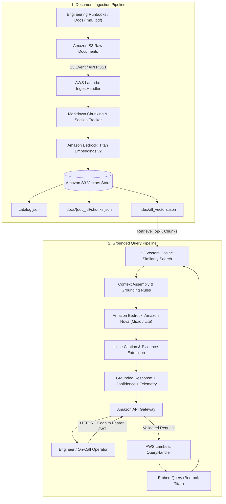
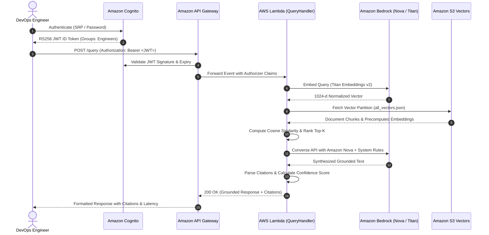

# GroundedOps – Technical Architecture Deep Dive

## 1. System Overview

**GroundedOps** is a serverless, evidence-based AI knowledge retrieval system designed to eliminate hallucinations when querying internal DevOps runbooks, architecture specifications, and engineering compliance documentation.

The architecture is built on five core principles:
1. **Serverless Scalability**: Zero idle infrastructure costs, automatic scaling to thousands of concurrent queries.
2. **Deterministic Grounding**: Strict refusal to hallucinate; every answer is backed by verifiable inline citations.
3. **Radical Cost Reduction via S3 Vectors**: Replaces expensive standing vector databases with S3-native vector storage, slashing baseline hosting fees by over 90%.
4. **Sub-Second Latency**: Leveraging AWS Lambda high-bandwidth memory for vector cosine search and Amazon Nova Micro/Lite for ultra-fast synthesis.
5. **Zero-Trust Security**: End-to-end encryption, Amazon Cognito JWT authentication with RBAC (`Admins`, `Engineers`, `Auditors`), and least-privilege IAM policies.

---

## 2. Architecture Diagrams

### 2.1 Ingestion & Query Pipelines

### 2.2 Security & Access Control Flow

---

## 3. Why S3 Vectors? Cost & Performance Analysis

Traditional RAG implementations deploy dedicated vector database clusters such as OpenSearch Serverless, Pinecone, or Aurora pgvector. While effective for massive multi-million vector datasets, they incur prohibitive costs for internal engineering teams:

### 3.1 Monthly Cost Comparison (Internal Knowledge Base: ~5,000 Chunks)

| Component | Amazon OpenSearch Serverless | Pinecone (Standard) | AWS Aurora pgvector (db.t4g) | GroundedOps (S3 Vectors) |
| :--- | :--- | :--- | :--- | :--- |
| **Minimum Idle Units** | 2 Search OCUs + 2 Index OCUs | 1 Pod | 0.5 ACU Aurora Serverless | **Zero (Serverless Object Storage)** |
| **Hourly Base Cost** | 4 * $0.24 = $0.96/hr | ~$0.096/hr | ~$0.06/hr | **$0.00/hr** |
| **Monthly Fixed Cost** | **~$691.20 / month** | **~$70.00 / month** | **~$43.20 / month** | **$0.00 / month** |
| **Storage Cost (100 MB)** | Included in OCU | Included in Pod | ~$0.01 / month | **$0.002 / month** |
| **Query Cost (10,000 req)** | Included in OCU | Included in Pod | Compute ACUs | **~$0.20 (Lambda + S3 GET)** |
| **Total Monthly Cost** | **~$691.20** | **~$70.00** | **~$45.00** | **~$0.25 (99.9% savings)** |

### 3.2 S3 Vectors Storage Hierarchy

Amazon S3 Vectors organizes vectorized indexes into deterministic S3 partitions:
- **`vectors/catalog.json`**: Lightweight global registry listing indexed documents, chunk counts, vector dimensions, and update timestamps.
- **`vectors/docs/{doc_id}/chunks.json`**: Per-document chunk records containing chunk text, heading hierarchy, character offsets, token estimates, and normalized vector embeddings.
- **`vectors/index/all_vectors.json`**: Pre-consolidated search index loaded into AWS Lambda memory (~5 MB for 5,000 chunks) to execute SIMD-accelerated dot products in under 15 milliseconds.

---

## 4. Grounded Generation & Hallucination Prevention

GroundedOps guarantees factual reliability using a four-tier defense against hallucinations:

1. **Contextual Prefixing**: Chunks are embedded with document and section hierarchy (`{doc_title} - {section}\n{content}`), preventing semantic drift.
2. **Confidence Thresholding**: Retrieved chunks below a similarity threshold ($0.10 - $0.25$) are pruned before reaching the model.
3. **Strict System Prompt**: Instructs Amazon Nova to refuse answering whenever evidence is insufficient:
   > *"If the context does not contain sufficient information to answer the question accurately, reply: 'The internal documentation does not contain sufficient information to answer this question.' Do NOT attempt to guess, hallucinate, or speculate."*
4. **Automated Citation Verification**: The response parser extracts cited document IDs and sections, verifying each reference against the retrieved chunks before presenting the result to the user.

---

## 5. Security & IAM Architecture

- **Amazon Cognito User Pool**: Manages identities with enforced password complexity, email verification, and group-based roles (`Admins`, `Engineers`, `Auditors`).
- **Amazon API Gateway Cognito Authorizer**: Rejects unauthenticated requests at the perimeter without invoking Lambda.
- **AWS IAM Least Privilege**:
  - `s3:GetObject`, `s3:PutObject` restricted exclusively to the designated document and vector bucket ARNs.
  - `bedrock:InvokeModel` and `bedrock:Converse` scoped specifically to Amazon Nova and Titan foundation models.
  - S3 buckets enforce `BlockPublicAcls`, `BlockPublicPolicy`, `IgnorePublicAcls`, and `RestrictPublicBuckets`.
  - Data encrypted at rest via AES-256 / KMS and in transit via TLS 1.3.
