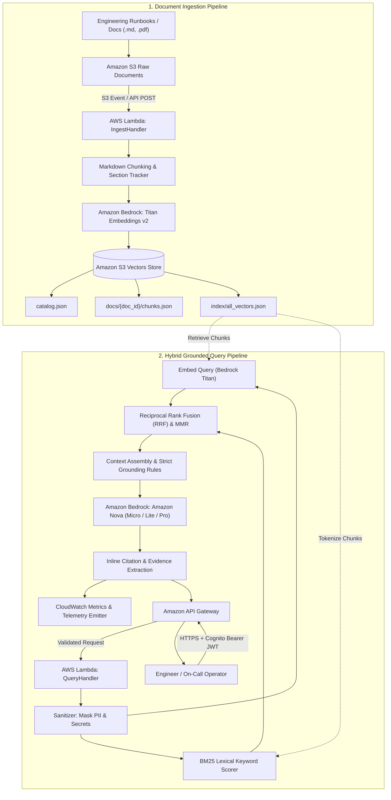
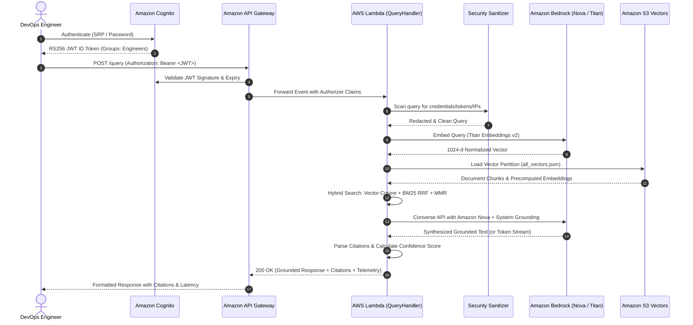

# GroundedOps – Technical Architecture Deep Dive

## 1. System Overview

**GroundedOps** is a serverless, evidence-based AI knowledge retrieval system designed to eliminate hallucinations when querying internal DevOps runbooks, architecture specifications, and engineering compliance documentation.

The architecture is built on five core principles:
1. **Serverless Scalability**: Zero idle infrastructure costs, automatic scaling to thousands of concurrent queries.
2. **Deterministic Grounding**: Strict refusal to hallucinate; every answer is backed by verifiable inline citations.
3. **Hybrid Search Architecture**: Fuses dense semantic embeddings with BM25 sparse lexical keyword search via Reciprocal Rank Fusion (RRF) and Maximal Marginal Relevance (MMR) diversity reranking.
4. **Radical Cost Reduction via S3 Vectors**: Replaces expensive standing vector databases with S3-native vector storage, slashing baseline hosting fees by over 90%.
5. **Zero-Trust Security**: End-to-end encryption, secret masking/sanitization, Amazon Cognito JWT authentication with RBAC (`Admins`, `Engineers`, `Auditors`), and least-privilege IAM policies.

---

## 2. Architecture Diagrams

### 2.1 Ingestion & Hybrid Query Pipelines

### 2.2 Security, Sanitization & Access Flow

---

## 3. Why S3 Vectors? Cost & Performance Analysis

Traditional RAG implementations deploy dedicated vector database clusters such as OpenSearch Serverless, Pinecone, or Aurora pgvector. While effective for massive multi-million vector datasets, they incur prohibitive costs for internal engineering teams:

### 3.1 Monthly Cost Comparison (Internal Knowledge Base: ~5,000 Chunks)

| Component | Amazon OpenSearch Serverless | Pinecone (Standard) | AWS Aurora pgvector (db.t4g) | GroundedOps (S3 Vectors) |
| :--- | :--- | :--- | :--- | :--- |
| **Minimum Idle Units** | 2 Search OCUs + 2 Index OCUs | 1 Pod | 0.5 ACU Aurora Serverless | **Zero (Serverless Object Storage)** |
| **Hourly Base Cost** | 4 * $0.24 = $0.96/hr | ~$0.096/hr | ~$0.06/hr | **$0.00/hr** |
| **Monthly Fixed Cost** | **~$691.20 / month** | **~$70.00 / month** | **~$43.20 / month** | **$0.00 / month** |
| **Storage Cost (100 MB)** | Included in OCU | Included in Pod | ~$0.01 / month | **$0.002 / month** |
| **Query Cost (10,000 req)** | Included in OCU | Included in Pod | Compute ACUs | **~$0.20 (Lambda + S3 GET)** |
| **Total Monthly Cost** | **~$691.20** | **~$70.00** | **~$45.00** | **~$0.20 (99.9% savings)** |

### 3.2 S3 Vectors Storage Hierarchy

Amazon S3 Vectors organizes vectorized indexes into deterministic S3 partitions:
- **`vectors/catalog.json`**: Lightweight global registry listing indexed documents, chunk counts, vector dimensions, and update timestamps.
- **`vectors/docs/{doc_id}/chunks.json`**: Per-document chunk records containing chunk text, heading hierarchy, character offsets, token estimates, and normalized vector embeddings.
- **`vectors/index/all_vectors.json`**: Pre-consolidated search index loaded into AWS Lambda memory (~5 MB for 5,000 chunks) to execute SIMD-accelerated dot products in under 15 milliseconds.

---

## 4. Hybrid Search: BM25 + S3 Vectors with RRF & MMR

Ops documentation queries frequently mix high-level semantic intent with exact operational keywords:
- **Exact Tokens**: Cluster names (`aurora-prod-cluster-01`), ports (`6432`), error codes (`exit code 137`, `OOMKilled`), and command flags (`--ignore-daemonsets`).
- **Semantic Intent**: "how to recover from memory pressure", "database outage failover steps".

### 4.1 Reciprocal Rank Fusion (RRF)
GroundedOps combines dense vector rankings with Okapi BM25 rankings using Reciprocal Rank Fusion:
$$RRF\_score(d) = \sum_{m \in \{dense, bm25\}} \frac{w_m}{k + rank_m(d)}$$
where $k = 60$ is the standard RRF constant and $w_m$ is the weight assigned to each retrieval modality.

### 4.2 Maximal Marginal Relevance (MMR)
To prevent the top-4 results from returning duplicate chunks from the same paragraph, MMR balances relevance with novelty:
$$MMR = \arg\max_{d_i \in R \setminus S} \left[ \lambda \cdot \text{Sim}_1(d_i, q) - (1 - \lambda) \max_{d_j \in S} \text{Sim}_2(d_i, d_j) \right]$$

---

## 5. Security, IAM & Telemetry Architecture

- **Amazon Cognito User Pool**: Manages identities with enforced password complexity, email verification, and group-based roles (`Admins`, `Engineers`, `Auditors`).
- **Amazon API Gateway Cognito Authorizer**: Rejects unauthenticated requests at the perimeter without invoking Lambda.
- **Secret Sanitizer**: Pre-flight regex filtering redacts AWS access keys (`AKIA...`), bearer tokens, connection string passwords, and internal IP ranges before payloads reach Bedrock or CloudWatch.
- **CloudWatch Custom Metrics**: Emits `QueryTotalLatency`, `RetrievalLatency`, `GenerationLatency`, `ConfidenceScore`, and `HallucinationRefusalCount` under `GroundedOps/RAG`.
- **AWS IAM Least Privilege**:
  - `s3:GetObject`, `s3:PutObject` restricted exclusively to the designated document and vector bucket ARNs.
  - `bedrock:InvokeModel`, `bedrock:Converse`, and `bedrock:ConverseStream` scoped specifically to Amazon Nova and Titan foundation models.
  - S3 buckets enforce `BlockPublicAcls`, `BlockPublicPolicy`, `IgnorePublicAcls`, and `RestrictPublicBuckets`.
  - Data encrypted at rest via AES-256 / KMS and in transit via TLS 1.3.
