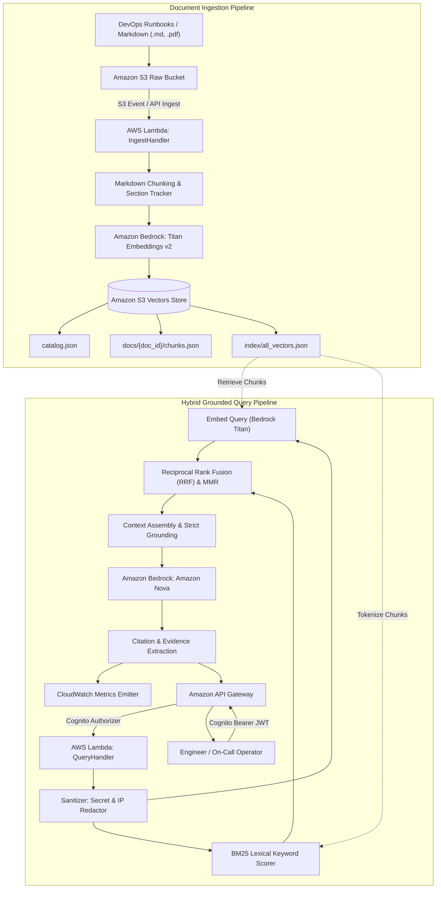

# GroundedOps – AI Knowledge Retrieval System

[](https://aws.amazon.com/)
[](https://aws.amazon.com/bedrock/)
[](https://aws.amazon.com/s3/)
[](https://aws.amazon.com/cognito/)
[](https://aws.amazon.com/cloudformation/)
[](https://www.python.org/)
[](tests/)

> **GroundedOps** is an enterprise-grade, serverless Retrieval-Augmented Generation (RAG) system built with **Amazon S3**, **AWS Lambda**, **Amazon Bedrock (Amazon Nova)**, and **S3 Vectors**. It provides strictly evidence-based, verifiable answers from internal documentation, engineering runbooks, and architectural specifications with zero standing infrastructure costs.

---

## 🎯 Key Capabilities & Upgrades

- **⚡ Hybrid Search Engine**: Fuses dense semantic vector embeddings (Amazon Bedrock Titan v2) with sparse lexical keyword matching (**BM25**) via **Reciprocal Rank Fusion (RRF)**—delivering pinpoint accuracy for operational codes, cluster IDs, and error numbers.
- **🎯 Maximal Marginal Relevance (MMR)**: Diversity reranker suppresses near-duplicate chunks from the same paragraph to maximize context coverage.
- **💬 Conversational Memory**: Supports multi-turn chat sessions with query context history across both the CLI and web dashboard.
- **🛡️ Secret Sanitizer & PII Guard**: Automatically scans and masks AWS Access Keys (`AKIA...`), bearer tokens, database passwords, and internal IP addresses before queries reach the model or logs.
- **📊 CloudWatch Telemetry Emitter**: Automatically emits operational metrics (`QueryTotalLatency`, `RetrievalLatency`, `ConfidenceScore`, `HallucinationRefusals`) under `GroundedOps/RAG`.
- **💰 S3 Vectors Architecture**: Replaces expensive managed vector databases (OpenSearch Serverless, Pinecone) with an optimized, serverless vector store native to Amazon S3—reducing standing hosting costs by over **90%** ($0.00/month idle cost).
- **🚫 Strict Grounding & Hallucination Refusal**: Enforces deterministic prompt templates, contextual chunk headers, and strict refusal rules. If internal documentation does not contain the answer, GroundedOps safely refuses to speculate.
- **📑 Verifiable Evidence Citations**: Every generated response includes verifiable inline citations, document IDs, section names, chunk identifiers, and similarity confidence scores.
- **🔒 Enterprise Zero-Trust Security**: Secured perimeter with **Amazon API Gateway**, **Amazon Cognito User Pools** (JWT token authorizer with RBAC groups: `Admins`, `Engineers`, `Auditors`), and least-privilege **AWS IAM** execution roles.
- **🤖 Real-Time Streaming Output**: Native support for Amazon Bedrock ConverseStream API token generation.
- **🔄 CI/CD Automation**: GitHub Actions workflow running tests, coverage, and validation on every pull request.

---

## 🏗️ Architecture Overview



---

## 💰 Why S3 Vectors? Cost Advantage Analysis

Traditional RAG systems require continuous cluster provisioning, resulting in high baseline monthly costs even with zero queries:

| Metric / Vector Store | Amazon OpenSearch Serverless | Pinecone (Standard) | AWS Aurora pgvector | **GroundedOps (S3 Vectors)** |
| :--- | :--- | :--- | :--- | :--- |
| **Minimum Idle Units** | 2 Search OCUs + 2 Index OCUs | 1 Pod | 0.5 ACU Serverless | **Zero (Pure Serverless)** |
| **Hourly Idle Cost** | $0.96 / hr | ~$0.096 / hr | ~$0.06 / hr | **$0.00 / hr** |
| **Monthly Standing Cost**| **~$691.20 / mo** | **~$70.00 / mo** | **~$43.20 / mo** | **$0.00 / mo** |
| **Storage Cost (100 MB)**| Included in OCU | Included in Pod | ~$0.01 / mo | **$0.002 / mo** |
| **Query Cost (10k req)** | Included in OCU | Included in Pod | Compute ACUs | **~$0.20 (Lambda + S3)** |
| **Total Monthly Cost**   | **~$691.20** | **~$70.00** | **~$43.20** | **~$0.20 (99.9% Savings)** |

---

## 📂 Repository Structure

```
GroundedOps/
├── .github/
│   └── workflows/
│       └── ci.yml               # GitHub Actions CI automated test workflow
├── cloudformation/
│   ├── template.yaml            # AWS CloudFormation / SAM infrastructure template
│   └── parameters-dev.json      # Development deployment parameters
├── src/
│   ├── handlers/
│   │   ├── ingest_handler.py    # S3 event & API Gateway ingestion Lambda handler
│   │   ├── query_handler.py     # API Gateway grounded query Lambda handler
│   │   └── health_handler.py    # System health & diagnostics Lambda handler
│   ├── core/
│   │   ├── bm25.py              # Okapi BM25 sparse lexical keyword search engine
│   │   ├── reranker.py          # Reciprocal Rank Fusion (RRF) & MMR diversity filter
│   │   ├── chunker.py           # Markdown & section-aware text chunker
│   │   ├── embeddings.py        # Amazon Bedrock embedding generator (Titan / Nova)
│   │   ├── vector_store.py      # S3 Vectors store & hybrid search engine
│   │   ├── nova_client.py       # Amazon Bedrock Amazon Nova client & streaming parser
│   │   └── rag_pipeline.py      # Coordinated end-to-end hybrid RAG orchestrator
│   └── utils/
│       ├── sanitizer.py         # Secret, PII & internal IP redactor
│       ├── telemetry.py         # CloudWatch custom metrics emitter
│       ├── logger.py            # Structured JSON CloudWatch logger
│       ├── response.py          # API Gateway CORS response formatter
│       └── auth_validator.py    # Cognito claims & role-based access validator
├── cli/
│   └── groundedops_cli.py       # Developer & admin CLI tool (Query, Ingest, Chat)
├── web/
│   ├── app.py                   # Streamlit conversational dashboard
│   ├── static/
│   │   ├── index.html           # Standalone HTML5/JS web application
│   │   └── style.css            # Custom CSS styling
│   └── README.md
├── sample_docs/
│   ├── 01_database_failover_runbook.md
│   ├── 02_microservices_architecture_spec.md
│   ├── 03_kubernetes_incident_response.md
│   └── 04_security_compliance_soc2.md
├── scripts/
│   ├── deploy.sh                # Automated CloudFormation deployment script
│   ├── setup_cognito_user.sh    # Cognito test user onboarding script
│   ├── ingest_sample_docs.sh    # Bulk document ingestion script
│   └── run_local_demo.sh        # Complete local demonstration script
├── tests/
│   ├── conftest.py              # Pytest fixtures & Moto S3 mocks
│   ├── unit/                    # 21 unit tests (BM25, RRF, MMR, Sanitizer, etc.)
│   └── integration/             # Integration tests for end-to-end grounding
├── template.yaml                # Root SAM deployment template
├── Makefile                     # Build & test automation targets
├── requirements.txt             # Lambda runtime dependencies
└── requirements-dev.txt         # Testing and development dependencies
```

---

## 🚀 Quickstart Guide

### 1. Local Setup & Testing (Offline Mode)

You can run GroundedOps locally without active AWS credentials using deterministic mock mode:

```bash
# Clone the repository
git clone https://github.com/KUMARAGURU-V-S/GroundedOps.git
cd GroundedOps

# Create virtual environment and install dependencies
python3 -m venv .venv
source .venv/bin/activate
pip install -r requirements-dev.txt

# Run complete test suite (all 22 tests passing)
pytest -v
```

### 2. Run the Local Demonstration

Execute the automated local demonstration script to ingest sample documentation, index into S3 Vectors, and run hybrid queries with citation extraction:

```bash
./scripts/run_local_demo.sh
```

---

## 💻 CLI Usage Guide

The `groundedops_cli.py` tool provides command-line control over ingestion, hybrid querying, and interactive chat:

```bash
# Ingest a single file
python3 cli/groundedops_cli.py ingest-file sample_docs/01_database_failover_runbook.md

# Ingest an entire directory of runbooks
python3 cli/groundedops_cli.py ingest-dir sample_docs/

# Query with Hybrid Search (BM25 + S3 Vectors RRF)
python3 cli/groundedops_cli.py query "How do I fix an exit code 137 OOMKilled error?"

# Query with MMR Diversity Filtering
python3 cli/groundedops_cli.py query "What is the token expiration for Cognito?" --mmr --top-k 4

# Interactive Conversational Chat Session (Multi-Turn Memory)
python3 cli/groundedops_cli.py chat --model amazon.nova-micro-v1:0

# List indexed documents in S3 Vectors
python3 cli/groundedops_cli.py list-docs

# View pipeline health and storage statistics
python3 cli/groundedops_cli.py stats
```

---

## 🌐 Web Dashboard & Chat Assistant

### Streamlit Application
```bash
streamlit run web/app.py
```
Features:
- **Conversational Assistant Tab**: Multi-turn chat interface with chat memory and collapsible verified citations.
- **Search Engine Toggle**: Switch between **Hybrid Search (BM25 + S3 Vectors RRF)** and **Dense Vectors Only**.
- **MMR Diversity Filter**: Suppresses redundant chunks in real time.
- **Model Selector**: Switch between Amazon Nova Micro, Nova Lite, and Nova Pro.
- **Telemetry Waterfall**: Latency breakdown across Embedding, S3/BM25 retrieval, and Nova synthesis.

### Standalone HTML5 Client
Serve the zero-dependency web interface:
```bash
python3 -m http.server 8080 --directory web/static
```
Open `http://localhost:8080` in your browser.

---

## ☁️ AWS CloudFormation Deployment

### 1. Deploy Infrastructure
Deploy the serverless stack (S3 Buckets, Cognito User Pool, IAM Roles, Lambda Functions, API Gateway):

```bash
export AWS_REGION="us-east-1"
./scripts/deploy.sh dev
```

### 2. Onboard a Cognito Test User
```bash
./scripts/setup_cognito_user.sh dev engineer@internal.corp "GroundedOps2026!" "Engineers"
```

### 3. Query the API with Hybrid Search & Chat History
```bash
export API_URL="https://<api-id>.execute-api.us-east-1.amazonaws.com/dev"
export TOKEN="<jwt-token-from-setup-script>"

curl -X POST "${API_URL}/query" \
  -H "Authorization: Bearer ${TOKEN}" \
  -H "Content-Type: application/json" \
  -d '{
    "question": "What is the command to failover the Aurora database?",
    "search_mode": "hybrid",
    "use_mmr": true,
    "top_k": 4
  }'
```

---

## 🧪 Testing

The repository includes 22 automated tests covering unit, mocks, and integration flows:

```bash
# Run all tests
pytest -v

# Run with test coverage report
pytest --cov=src --cov-report=term-missing tests/
```

Test breakdown:
- `tests/unit/test_bm25.py`: Okapi BM25 keyword precision, IDF scoring, and tokenization.
- `tests/unit/test_reranker.py`: Reciprocal Rank Fusion (RRF) and Maximal Marginal Relevance (MMR).
- `tests/unit/test_sanitizer.py`: Automatic secret masking (AWS keys, tokens, IP addresses).
- `tests/unit/test_chunker.py`: Heading extraction, sliding window segmentation, and boundary handling.
- `tests/unit/test_embeddings.py`: L2 normalization, dimension checks, and feature hashing.
- `tests/unit/test_vector_store.py`: S3 index storage, cosine similarity ranking, and catalog deletion.
- `tests/unit/test_nova_client.py`: Grounded generation, citation parsing, and hallucination refusal.
- `tests/unit/test_handlers.py`: API Gateway and S3 event Lambda proxy handlers.
- `tests/integration/test_end_to_end_local.py`: Full document ingestion and retrieval validation.

---

## 📄 License

This project is licensed under the Apache 2.0 License - see the [LICENSE](LICENSE) file for details.
